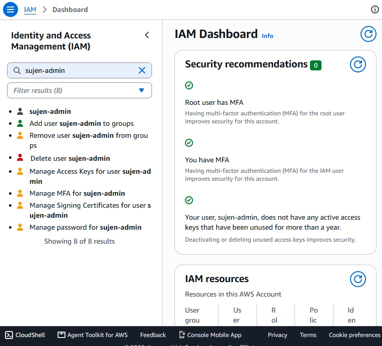
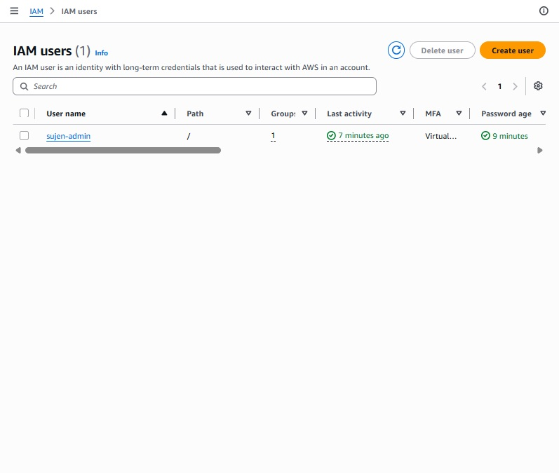
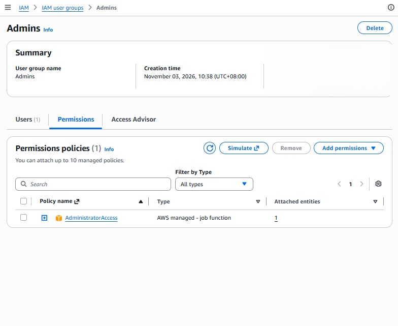

# AWS IAM Security Setup

## Project Overview
A hands-on AWS project applying Identity and Access Management (IAM) security best practices to secure an AWS account before building further cloud projects.

## AWS Services Used
- AWS Identity and Access Management (IAM)
- AWS Multi-Factor Authentication (MFA)

## Project Implementation

### 1. Root Account Protection
- Verified that MFA is enabled on the root user.
- Confirmed the root user has no access keys.
- Reserved the root account for emergency and account-level tasks only.

### 2. Admin IAM User for Daily Work
- Created an IAM user named `sujen-admin` with AWS Management Console access.
- Enabled a virtual MFA device for the IAM user.
- Used a separate, custom password from the root account.
- No access keys were created, reducing the risk of credential leaks.

### 3. Group-Based Permissions
- Created an IAM user group named `Admins`.
- Attached the AWS managed policy `AdministratorAccess` to the group.
- Added `sujen-admin` to the group instead of attaching policies directly to the user.

## Account Structure

| Identity | Purpose | MFA | Access Keys |
|----------|---------|-----|-------------|
| Root user | Emergency and account-level tasks only | Enabled | None |
| sujen-admin | Daily administration | Enabled | None |

## Security Practices
- Avoided using the root account for everyday tasks.
- Enabled MFA on all identities with console access.
- Managed permissions through groups, following AWS best practice.
- Did not create long-term access keys.
- Removed AWS account IDs and ARNs from screenshots before publishing.

## Skills Demonstrated
- AWS IAM user and group management
- Multi-factor authentication setup
- Least privilege and identity security concepts
- AWS account security best practices
- Cloud project documentation

## Screenshots

### IAM Security Recommendations

### IAM Users

### Admins Group Permissions

## Related Projects
- [AWS Cloud Monitoring Lab](https://github.com/sujen2136-cpu/aws-cloud-monitoring-lab)

## Project Status
Completed

## Author
Sujendran
